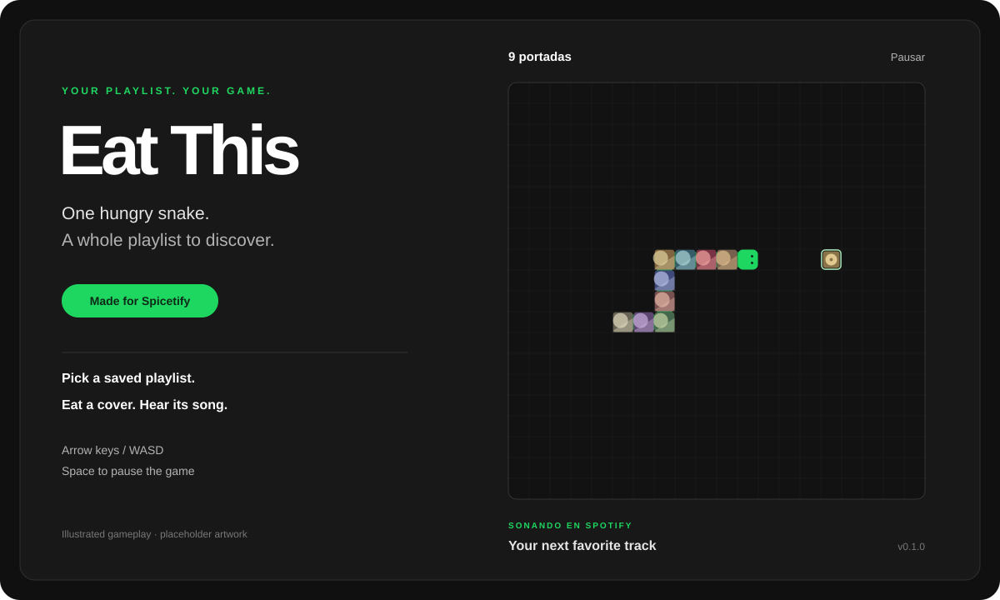

<div align="center">

# Eat This

**Your playlists. One hungry snake.**

A minimal Snake game inside Spotify desktop, powered by Spicetify.
Eat album covers and hear the tracks behind them.

[](https://github.com/Eduardo-Gv17/eat-this-spicetify/releases/latest)
[](https://github.com/Eduardo-Gv17/eat-this-spicetify/actions/workflows/test.yml)
[](LICENSE)
[](https://spicetify.app/)

**[Download eat-this.zip](https://github.com/Eduardo-Gv17/eat-this-spicetify/releases/latest/download/eat-this.zip)** · **[Installation](#installation)** · **[Report a bug](https://github.com/Eduardo-Gv17/eat-this-spicetify/issues/new?template=bug_report.md)**



<sub>Illustrated preview with placeholder covers. Your playlist provides the real artwork.</sub>

</div>

## What it does

Browse your saved playlists, pick one, and play. Each cover you eat grows the snake and requests that track in Spotify's own player. The board keeps a quiet, dark look, with connected cover tiles, a green head, and a small outline around the next cover.

| Feature | How it works |
| --- | --- |
| Your library | Search saved playlists, including playlists inside folders. |
| One-click loading | Click a playlist card to load its tracks, then start playing. |
| Spotify playback | Uses the desktop player and confirms track changes. |
| Song fragments | Choose an estimated intense section, 0:30, 0:45, or the beginning. |
| Three speeds | Relaxed, normal, and fast. |
| Playlist shortcuts | Right-click a playlist and choose **Jugar Eat This**. |
| Link fallback | Paste a playlist link if library browsing is unavailable. |

The current in-app interface is in **Spanish**. This README and the installation guide are in English.

## Requirements

| Requirement | Status |
| --- | --- |
| Spotify desktop | Required; this is not a web-player extension. |
| Spicetify | Must already be installed and applied. [Setup guide](https://spicetify.app/docs/getting-started). |
| Windows | Gameplay has been tested by the project owner. |
| Linux / macOS | Manual installation instructions included; not yet tested by the project owner. |
| Spotify Free / Premium | Uses your account's playback capabilities. Free-account on-demand playback is not guaranteed. |
| Exact client versions | A version-by-version compatibility matrix has not been recorded yet. |
| Node.js | Only needed for development and tests, not for playing. |

## Installation

### Windows: download, copy, enable

1. **[Download eat-this.zip](https://github.com/Eduardo-Gv17/eat-this-spicetify/releases/latest/download/eat-this.zip)** and extract it. Use this release asset rather than GitHub's **Source code** downloads.
2. Copy the extracted **`eat-this` folder** into your Spicetify **`CustomApps`** directory. The usual Windows location is `%APPDATA%\spicetify\CustomApps\`. If your installation uses another location, run `spicetify -c`: `CustomApps` sits beside the configuration file it prints.
3. Open PowerShell and run:

   ```powershell
   spicetify config custom_apps eat-this
   spicetify apply
   ```

Open **Eat This** in Spotify's sidebar. Choose a playlist under **Tus playlists guardadas**, click its card, and press **Empezar partida**.

Your installed folder must look like this, with no extra nested `eat-this` directory:

```text
CustomApps/
└── eat-this/
    ├── index.js
    ├── manifest.json
    ├── engine.js
    ├── spotify.js
    ├── board.js
    ├── extension.js
    └── style.css
```

### Windows: install from a source checkout

If you cloned this repository or downloaded its source code, run this from the repository folder:

```powershell
powershell -ExecutionPolicy Bypass -File .\install.ps1
```

The script locates your existing Spicetify configuration, copies the app, enables it, and runs `spicetify apply`. Applying changes may restart Spotify. It does not install Spotify or Spicetify.

### Linux / macOS

Copy `eat-this` into the `CustomApps` directory beside the configuration reported by `spicetify -c` (commonly `~/.config/spicetify/CustomApps/`), then run:

```sh
spicetify config custom_apps eat-this
spicetify apply
```

These platforms still need real-client testing. Contributions with version details are welcome.

## Controls

| Action | Control |
| --- | --- |
| Move | Arrow keys or WASD |
| Pause / resume the game | Space or the on-screen button |
| Activate keyboard controls | Click the board |
| Try again | **Volver a jugar** after a collision |
| Pick another playlist | **Cambiar playlist** |

Music continues when you pause, lose, or leave the app. The game pauses when the window loses focus. Playback follows the active Spotify device; choose this computer if you want local audio.

## Where songs start

| In-app option | Behavior |
| --- | --- |
| **Parte intensa (estimada)** | Tries to use a louder section from available musical analysis. Without a ready result, starts around 33% of the track, or 0:30 if duration is unknown. |
| **Desde 0:30** | Starts at 30 seconds. |
| **Desde 0:45** | Starts at 45 seconds. |
| **Desde el inicio** | Starts from the beginning. |

An estimated intense section is **not** the most-listened timestamp and is not guaranteed to be the chorus. Spotify does not provide those listening statistics through the APIs used here. Positions are clamped to leave at least ten seconds before the end when duration is known. Late analysis does not unexpectedly seek a track that has already started.

## Updates and removal

**Update:** download the new ZIP, replace the **entire** `CustomApps/eat-this` folder contents, then run `spicetify apply`. Include the new manifest and all JavaScript files. From a source checkout, you can rerun `install.ps1`.

**Disable:**

```sh
spicetify config custom_apps eat-this-
spicetify apply
```

After disabling it, you may delete the `eat-this` folder from `CustomApps`.

## Troubleshooting

| Problem | What to try |
| --- | --- |
| Eat This is missing from the sidebar | Check the folder layout above, enable `eat-this`, run `spicetify apply`, and reopen Spotify. |
| Your library does not load | Try **Actualizar**, or expand **O usar un enlace de playlist**. Internal APIs can change between client versions. |
| A playlist contains fewer tracks | Duplicates are removed. Local files, episodes, and tracks marked unavailable are skipped. |
| A track does not play or seek | Check the active device, availability, and account playback restrictions. Try another song or choose **Desde el inicio**. |
| A change briefly plays another track | Requests are serialized and pending targets collapse to the most recent choice. A request already sent to Spotify can still play briefly. |
| The estimated section falls back | Some tracks or client versions do not provide audio analysis. The game can continue without it. |
| An update broke integration | Include your OS, Spotify version, Spicetify version, and steps to reproduce in an issue. |

## Development and contributing

No build step and no npm dependencies are required. The app uses Spotify's exposed React instance and a canvas renderer.

```sh
node --test tests/game.test.cjs
node scripts/check-package.cjs
```

On Windows, build the distributable ZIP with:

```powershell
powershell -File .\scripts\package.ps1
```

| File | Purpose |
| --- | --- |
| `eat-this/index.js` | Screens, library selection, controls, and game lifecycle |
| `eat-this/engine.js` | Snake rules without Spotify or DOM dependencies |
| `eat-this/spotify.js` | Library, playlists, playback coordination, and fragment estimates |
| `eat-this/board.js` | Minimal board and snake drawing |
| `eat-this/extension.js` | Playlist context-menu entry |
| `eat-this/manifest.json` | Installed Custom App metadata and subfiles |

Bug reports, platform testing, translations, and pull requests are welcome. See [CONTRIBUTING.md](CONTRIBUTING.md). Automated tests cover the engine and mocked Spotify integration; real-client behavior still needs testing after integration changes.

## Project background

This is the dedicated Spicetify version of [the original Eat This web project](https://github.com/Eduardo-Gv17/Spotify--Eat-this-playlist-FOR-EVERYONE-ver.). The web version remains separate, with its own installation and playback approach.

An independent community project inspired by Spotify's Eat This Playlist. Not affiliated with or endorsed by Spotify or Spicetify. Music and playlist artwork are supplied by Spotify at runtime, not bundled in the download.

Code is available under the [MIT license](LICENSE).
